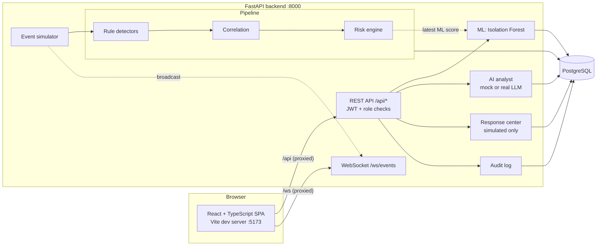

# Architecture

An educational SOC in one repository: synthetic telemetry goes in; detections,
incidents, risk scores, AI-written investigations and (simulated) response
actions come out, with an audit trail of everything an analyst did.

> **Nothing here touches a real system.** Telemetry is generated by the built-in
> simulator, indicators use non-routable addresses (RFC 5737 / RFC 1918) and
> `.invalid` domains, and approving a response action only records a simulated
> result. These properties are enforced by tests, not just stated.

## The big picture



The Vite dev server proxies `/api` and `/ws` to the backend, so the browser only
ever talks to one origin.

## What happens to one event

1. **Ingest.** The simulator (or any caller) stores an `events` row.
2. **Detect.** Every *enabled* rule inspects the event. A match writes one `alerts` row that records the
   events that triggered it. Rules are read from the database on every event, so editing a threshold in the UI
   changes behaviour immediately, with no restart.
3. **Correlate.** The new alert is scored against open incidents from the last 15 minutes.
   Shared username (+3) or source IP (+3), hostname (+2), destination IP (+2), recent activity (+1) and a
   new kill-chain stage (+1) are summed; it joins an incident if there is one strong entity match and the
   score reaches 3, otherwise it opens a new one. The reasons are stored on the incident (the *correlation trail*).
4. **Score.** The incident's 0-100 risk score is recomputed (see below) and stored with its full breakdown.
5. **Stream.** Event, alert and incident messages are broadcast on the WebSocket for the live views.
6. **Investigate (on demand).** An analyst asks the AI analyst for a report ([ai-analyst.md](ai-analyst.md)).
7. **Respond (on demand).** Recommended actions appear in the Response Center; approving or rejecting one is
   recorded and audited, and the outcome is *simulated*.

## Detection rules

| Rule | Fires when | Default configuration |
|---|---|---|
| Brute Force | repeated failed logins from one source IP | 5 failures within 5 minutes |
| Suspicious PowerShell | a process event for `powershell.exe` carries a suspicious-pattern marker | flagged process `powershell.exe` |
| Impossible Travel | a login-location change follows a successful login by the same user | within 10 minutes |
| DNS Anomaly | one source issues too many DNS queries | 6 queries within 60 seconds |
| Abnormal Network | many distinct destinations, or a large outbound volume | 10 destinations; 50 MB = high, 200 MB = critical |

A burst is debounced: while a threshold is still exceeded, repeated matches for the same rule and source (and user, where the rule has one) within 5 minutes do not each raise a new alert.

## Risk score (0-100)

| Factor | Max | How it is computed |
|---|---|---|
| Severity | 30 | worst alert severity: low 8, medium 18, high 25, critical 30 |
| Asset criticality | 20 | registered host criticality (5/10/15/20); unregistered hosts default to medium |
| Detection confidence | 15 | configured confidence of the rule(s): low 5, medium 10, high 15 (highest wins) |
| Correlated alerts | 20 | 4 points per alert, capped |
| ML anomaly | 15 | latest model's anomaly score for the incident's source IP; 0 if no model or no match |

The breakdown is stored with the incident and shown in the UI, so the number is always explainable.

## Data model

| Table | Purpose |
|---|---|
| `users` | accounts: bcrypt hash, role, active flag |
| `events` | raw telemetry (`EVT-000001`...) |
| `alerts` | rule matches (`ALT-000001`...), linked to the events that triggered them |
| `incidents` | correlated alerts (`INC-1001`...), risk score and breakdown, correlation trail |
| `incident_events` | links an incident to its evidence events |
| `detection_rules` | live, editable rule configuration |
| `assets` | host names and criticality |
| `ml_training_runs`, `ml_predictions` | each training run and its per-window anomaly scores |
| `ai_investigations` | stored AI reports |
| `response_actions` | recommended / approved / rejected actions (`RESP-000001`...) |
| `audit_logs` | append-only record of privileged actions |

Human-readable ids come from PostgreSQL sequences, which is why the test suite runs on a real PostgreSQL rather than SQLite.
The schema is created by Alembic migration `0001` (see `backend/alembic/versions/`).

## Security model

| Concern | How it is handled |
|---|---|
| Authentication | bcrypt password hashes; signed JWT (HS256) with an expiry; unknown user and wrong password give the same error |
| Authorization | three roles. **VIEWER** is read-only; **SOC_ANALYST** and **ADMIN** may change state. The role is read from the database on every request, so a token claiming a higher role gains nothing |
| Accountability | every privileged action is written to an append-only audit log (there is no API to edit or delete it) |
| Safe response | approving an action records a simulated result and never modifies anything real |
| Uploads | only `.csv` / `.parquet`; filenames are reduced to a bare name; request-supplied filenames cannot escape the data folders |
| Input validation | request bodies and filters are validated; bad input returns 4xx, not 500 |
| Test data | non-routable IPs and `.invalid` domains only |

### Known limitations (deliberate, documented)

* `/ws/events` is unauthenticated. It carries only synthetic demo telemetry; real use would require a token.
* A *denied* (403) request is not written to the audit log; only successful privileged actions are.
* Demo accounts have public passwords. `SEED_DEMO_USERS=false` disables them; the server warns when demo settings are
  used outside a development environment.
* The Threat Intelligence page is intentionally a statement of non-scope: no external feeds are queried.
* The frontend container runs the Vite *development* server (hot reload), which is right for a demo but not for production.
* The real-LLM path is tested against a stub server, not a live model.

## Repository layout

```text
backend/        FastAPI app (app/), Alembic migrations (alembic/), tests (tests/)
frontend/       React + TypeScript SPA, Vitest tests alongside the code
scripts/        seed_demo_data, train_model, prepare_nslkdd, generate_api_docs, run_tests.sh, db/init-test-db.sql
data/ ml/       uploaded datasets, processed data, trained models (git-ignored contents)
docs/           this documentation
docker-compose.yml, .env.example
```
